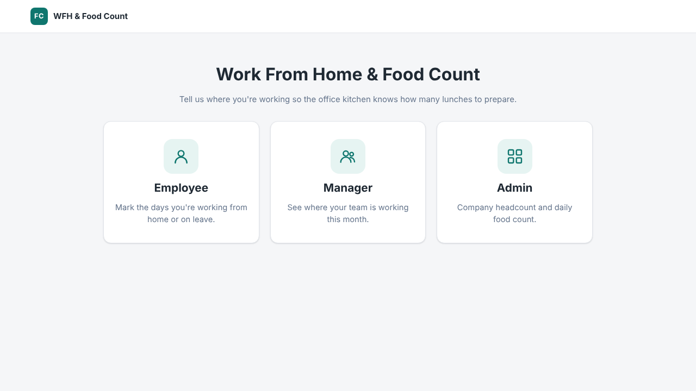
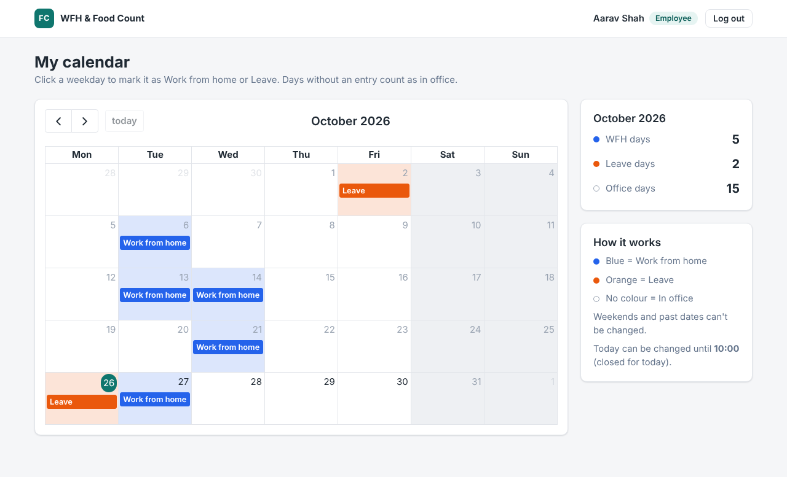
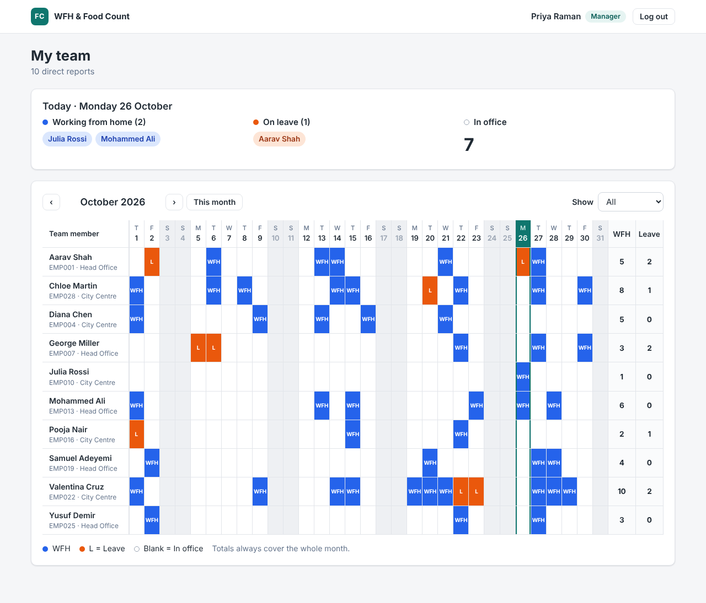
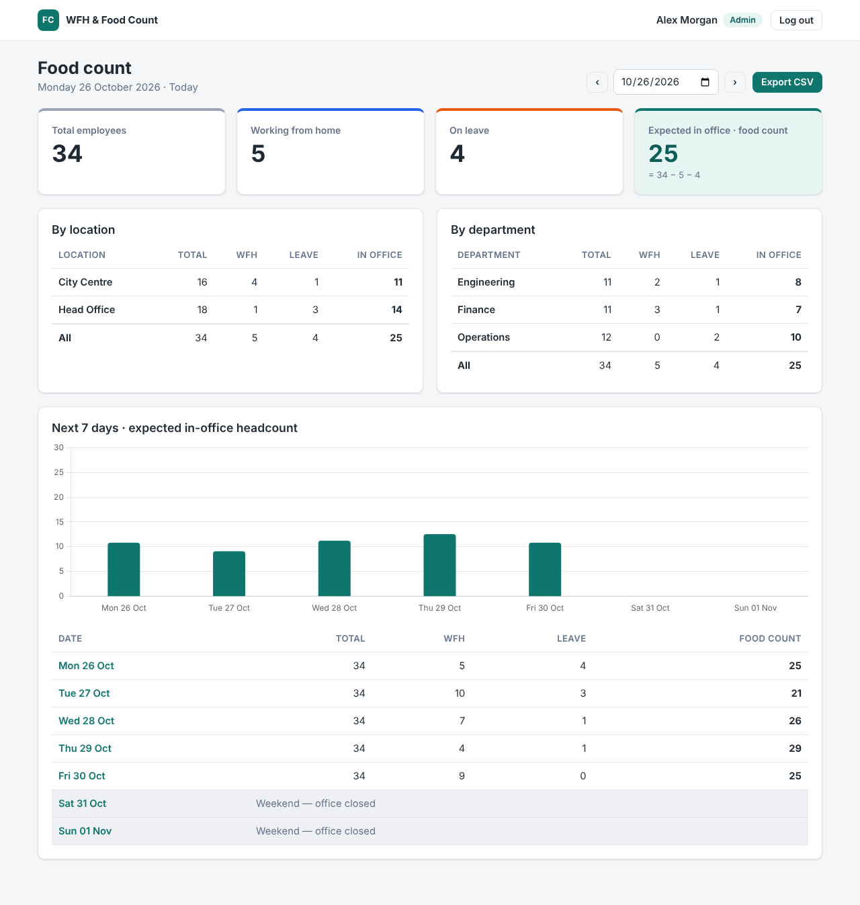

# WFH & Food Count

A small web app where employees mark the days they work from home or are on
leave, managers see where their team is, and admins get a daily
**expected in-office headcount** so the kitchen knows how much food to prepare.

Python + Flask, SQLite, server-rendered Jinja templates, plain CSS and a little
vanilla JS. No build step.



## Quick start

```sh
./start.sh
```

That creates a virtualenv in `.venv`, installs the requirements and starts the
server on <http://127.0.0.1:5000>. On first run the SQLite database
(`instance/foodcount.sqlite3`) is created, the users are loaded from
`data/roster.csv`, and random sample WFH / leave entries are added so the
dashboards have something to show.

Manual steps (also works on Windows):

```sh
python3 -m venv .venv
source .venv/bin/activate          # Windows: .venv\Scripts\activate
pip install -r requirements.txt
python run.py
```

To throw away all data and start again with fresh sample entries:

```sh
python seed.py --reset --sample-entries
```

The calendar (FullCalendar) and chart (Chart.js) are loaded from the jsDelivr
CDN, so the browser needs internet access.

## Deploy to Railway

The repo is ready for [Railway](https://railway.com): `railway.json` starts the
app with gunicorn (`wsgi.py`), which listens on the `PORT` Railway provides.

1. **Create the service.** In Railway: *New Project → Deploy from GitHub repo*,
   pick this repository. Under the service's *Settings → Source*, choose the
   branch to deploy.
2. **Add a volume** to the service with mount path `/data`. Without it the
   SQLite database is wiped on every deploy.
3. **Set variables** (service → *Variables*):

   | Variable | Value | Why |
   |----------|-------|-----|
   | `DATABASE` | `/data/foodcount.sqlite3` | keep the database on the volume |
   | `APP_TIMEZONE` | your zone, e.g. `Asia/Kolkata` | Railway runs on UTC; this sets "today" and the 10:00 cutoff |
   | `SESSION_COOKIE_SECURE` | `1` | Railway serves HTTPS |
   | `SEED_DEMO_DATA` | `1` | optional: add random sample WFH / leave entries if there are none. Leave it off for real use. |
   | `INITIAL_PASSWORD` | e.g. `1234` | optional: password for newly added people (default `1234`) |
   | `CUTOFF_HOUR` | e.g. `10` | optional |

   `SECRET_KEY` is optional: if unset, one is generated and stored on the
   volume next to the database.
4. **Expose it:** *Settings → Networking → Generate Domain*.

Run one replica only: a SQLite file on a volume can't be shared between
replicas. Two gunicorn workers in that one replica is fine for this load.

Users are synced from `data/roster.csv` on every start, so to change people
just edit that file, push, and Railway redeploys.

> **Heads-up:** everyone starts with the same password (`1234`), so anyone who
> knows an employee ID and has the URL can log in as that person, including
> the admin. Ask people to use **Change password** (in the header) after their
> first login, or set a less guessable `INITIAL_PASSWORD` before the first
> deploy.

## Users and logins

**Username = employee ID. Initial password = `1234` for everyone.**

| Role | ID | Name | Team |
|------|----|------|------|
| Admin | `64061732` | SATHISH KUMAR M | reports to Ritu |
| Manager | `64120538` | Anand Shanbag | Internal Controls (4) |
| Manager | `64149786` | Suresh K | Marketing Hub (5) |
| Manager | `40104978` | Rajesh P | STP (12) |
| Manager | `11223344` | Ritu | manages Sathish Kumar M |
| Employee | the 21 IDs in `data/roster.csv` | | |

### Changing users: `data/roster.csv`

```
employee_id,name,role,manager,department,location
64120538,Anand Shanbag,manager,,Internal Controls,
40103405,BALAJI K,employee,Anand Shanbag,Internal Controls,
```

- `role` is `employee`, `manager` or `admin`.
- `manager` is the manager's **name** exactly as written on their own row
  (case and extra spaces don't matter).
- `department` and `location` drive the admin breakdowns; `location` is empty
  for now.

On every start (or `python seed.py`), the app makes the users match the file:
new rows are added with `INITIAL_PASSWORD`, changed rows are updated (passwords
people have changed are kept), and people removed from the file are deleted
along with their WFH / leave entries. A mistake in the file (unknown manager,
duplicate ID) stops the app from starting and the log says which line.

## The portals

The home page has one button per role. Each goes to that role's login page;
after login you land on your dashboard. Every page checks the role, so an
employee can't open the manager or admin pages (and logged-out visitors are
sent back to the home page).

### Employee: my calendar



- Month calendar of your own entries. Click a weekday and choose
  **Work from home**, **Leave** or **Clear** (back to in office).
- Blue = WFH, orange = leave, no colour = in office. Weekends are greyed out.
- Past dates can't be edited, and today is locked from the cutoff time
  (`CUTOFF_HOUR`, default 10:00). The server enforces these rules, not only the UI.
- Side panel: WFH, leave and office days for the month you're viewing.

### Manager: team summary



- Only your direct reports.
- "Today" panel: who's working from home or on leave today.
- Month grid: people as rows, days as columns, same colours. Previous / next
  month navigation.
- Filter: all, WFH only or leave only. The per-person WFH / leave totals always
  cover the whole month.

### Admin: food count



- Today's numbers by default: total employees, WFH, leave and
  **expected in office = total − WFH − leave**.
- Date picker (plus previous / next day) to look at any date.
- Breakdown by location and by department.
- 7-day forward view as a table and bar chart. Weekends show as office closed.
- **Export CSV** for the selected date: employee ID, name, department, location
  and status (`WFH`, `LEAVE`, `IN_OFFICE`).

## Configuration

Settings live in `app/config.py`. Each one can be overridden with an
environment variable of the same name.

| Setting          | Default                        | Meaning |
|------------------|--------------------------------|---------|
| `CUTOFF_HOUR`, `CUTOFF_MINUTE` | `10`, `0`        | Time after which today's status is locked |
| `APP_TIMEZONE`   | server local time              | IANA zone for "today" and the cutoff, e.g. `Asia/Kolkata` |
| `DATABASE`       | `instance/foodcount.sqlite3`   | SQLite file path |
| `SECRET_KEY`     | random, saved as `secret_key` next to the database | Session signing key |
| `HEADCOUNT_ROLES`| employee, manager, admin       | Which roles count towards the food count |
| `SESSION_COOKIE_SECURE` | off                | Set to `1` when served over HTTPS |
| `ROSTER_FILE`    | `data/roster.csv`              | Who can log in (synced on every start) |
| `INITIAL_PASSWORD` | `1234`                       | Password for people newly added from the roster |
| `SEED_DEMO_DATA` | off                            | `1` = `wsgi.py` adds random sample entries when there are none |
| `HOST`, `PORT`, `FLASK_DEBUG` | `127.0.0.1`, `5000`, off | Dev server options (read by `run.py`; gunicorn reads `PORT`) |

## Project layout

```
run.py               start the dev server (creates + seeds the DB on first run)
wsgi.py              production entry point for gunicorn (used on Railway)
railway.json         Railway start command and health check
seed.py              roster sync + optional sample entries
data/roster.csv      the people who can log in
start.sh             one-command setup + run
app/
  __init__.py        application factory
  config.py          settings
  schema.sql         tables: users, attendance_entries
  db.py              SQLite connection per request
  attendance.py      business rules: edit cutoff, headcount, forecast
  auth.py            home, login/logout, role guard, CSRF
  employee.py        employee calendar + JSON API
  manager.py         manager team grid
  admin.py           admin dashboard + CSV export
  templates/         Jinja templates (base, home, login, one folder per role)
  static/            style.css, app.js, employee.js, admin.js
tests/test_app.py    pytest suite
```

### Data model

- **users**: `id`, `employee_id` (unique, the username), `name`,
  `password_hash` (werkzeug), `role` (employee / manager / admin),
  `manager_id` → users, `department`, `location`
- **attendance_entries**: `id`, `user_id`, `date`, `status` (WFH / LEAVE),
  `created_at`, `updated_at`, unique on `(user_id, date)`.
  No row means in office.

## Tests

```sh
pip install -r requirements-dev.txt
python -m pytest
```

The suite covers login and logout, cross-role blocking, CSRF, the employee
edit rules (past, weekend, cutoff), the manager's team scoping and filter,
the food-count formula and the CSV export.

## Notes and next steps

- Out of scope for this prototype, with room left for them in the design:
  approval workflows (add an approval state column to `attendance_entries`),
  email notifications, SSO (replace the login view in `auth.py`), recurring
  WFH patterns, and public holidays (extend `attendance.is_weekend` /
  `edit_block_reason` and `headcount`).
- Managers and the admin count towards the headcount but don't have their own
  calendar yet, so they always count as in office.
- `run.py` uses Flask's development server; for hosting use gunicorn via
  `wsgi.py` (see *Deploy to Railway*).
